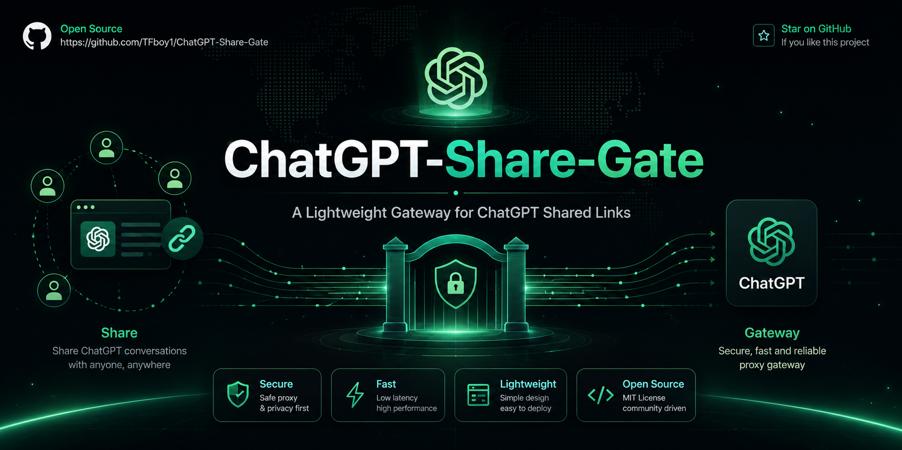

 

 

 

Playwrightを利用してログイン済みのローカルChatGPTブラウザセッションを自動制御し、 
**家族や友人と安全に1つのChatGPTアカウント（Plusなど）を共有しながら、会話履歴を完全に隔離できる**プライベート共有システム。

### 💡 開発の背景
月額料金の分担や、DALL-E 3などの高度なクォータを共有するために、1つのChatGPT Plusアカウントを友人と共用することは一般的です。しかし、1つのブラウザアカウントを直接複数人で共用すると、次の2つの重大な問題が発生します：
1. **プライバシーの漏洩**: 全員がお互いのチャット履歴を見ることができ、プライベートやビジネスの対話内容が漏洩します。
2. **同時実行時の衝突**: 複数人が同時にメッセージを送信すると、ChatGPTのページがエラーを起こしたり、メッセージ生成が中断されたり、他人の会話コンテキストと混ざってしまいます。

**本プロジェクトは、これらの問題をエレガントに解決します。**
本システムはローカルゲートウェイとして機能し、**Telegramボット** と **Streamlit Web UI** を介してユーザーからのリクエストを収集し、バックグラウンドのキューイングメカニズム（FIFO：先入れ先出し）を使用して、ブラウザを順次（シリアル）自動制御します。
- **厳格なコンテキスト隔離**: 友人はそれぞれの個別Telegramチャット画面で対話するため、他の人に履歴を見られることはありません。
- **衝突の完全回避**: バックグラウンドがリクエストの送信を順序化（シリアル化）するため、ChatGPTページがクラッシュするのを防ぎます。
- **仕様の明確化**: 本プロジェクトは、Web APIを外部向けに逆プロキシ（Reverse Proxy）化するためのものではありません。親しい人の間でアカウントを共有し、会話のプライバシーを隔離するために設計されたユーザー向けUIツールです。

### 📊 一般的な「Web-to-API」逆プロキシプロジェクトとの比較

| 比較項目 | 一般的なWeb逆プロキシAPI  (Chat2API / Pandora-Next など) | 本プロジェクト (ChatGPT-Share-Gate) |
| :--- | :---: | :---: |
| **主な目的** | 🛠️ Web APIをOpenAI互換のAPI形式に逆コンパイルし、外部の自作ツールから呼び出す | 👥 友人同士で1つのアカウントを安全に共有し、チャット用の独立したUIを提供する |
| **導入のしやすさ** | ❌ **UI非搭載**: APIエンドポイントのみを提供するため、別途フロントエンドUIの導入や連携が必要 | 🟢 **2つのUIを同梱**: TelegramボットとStreamlit管理者UIが最初から内蔵され、即時利用可能 |
| **会話のプライバシー隔離** | ⚠️ **手動設定が必要**: サードパーティ製UI側でユーザー認証やトークン管理、DB構築などを自作する必要がある | 🟢 **標準機能で隔離**: ユーザーごとのTelegramチャット画面を完全に分離。会話履歴が混ざる心配は不要 |
| **アカウント凍結のリスク** | ❌ **極めて高い**: HTTPリクエストの偽装やAPIのハックを行うため、Cloudflareや公式に検知されやすい | 🟢 **極めて低い**: **実際にPC上で稼働しているChrome/Edgeブラウザ**を自動操作するため、人間による手動操作と区別されにくい |
| **同時実行時の衝突** | ❌ **並列エラー**: 同一アカウントで同時にAPIリクエストを送ると、頻繁なレート制限やエラーが発生する | 🟢 **キューによる順序化**: リクエストをFIFOキューで制御するため、複数人の同時入力でも画面が壊れず順次処理される |
| **マルチモーダル対応** | ⚠️ **制限あり**: 画像アップロード（Vision）やDALL-E 3画像のダウンロードが仕様変更によって動かなくなりやすい | 🟢 **完全対応**: Playwrightを介してリアルタイムでブラウザに画像をアップロードし、生成画像を自動検知して送信 |

---

## 🌟 主な機能

1. **セッション隔離**: ユーザーは自分専用のTelegramチャット画面で対話します。裏側では1つのログイン済みブラウザを共有していますが、お互いのチャット履歴が漏洩することはありません。
2. **API利用料が不要**: 本体のGoogle ChromeやEdgeブラウザを駆動させるため、高価なAPI利用料を支払う必要がなく、Plusサブスクリプションの機能をフル活用できます。
3. **2種類のユーザーインターフェース**:
   - 🤖 **Telegramボット**: 外出先からでもTelegram上でChatGPTと対話・画像生成が可能。
   - 💻 **Streamlit管理者UI**: ブラウザの稼働状態の確認、直接チャット、セッションのリセットを行える美しい管理者ボード。
4. **マルチモーダル対話**:
   - 💬 **テキストチャット**: 文脈を維持したテキスト対話。
   - 🎨 **画像生成**: ChatGPTが生成したDALL-E 3の画像を自動的に検知・ローカルに保存し、Telegramに転送。
   - 🖼️ **画像解析（Vision）**: 画像ファイルを送信し、「この画像について説明して」などの指示を送信可能。
5. **ブラウザとプロキシの自動フォールバック**:
   - 🌐 **ブラウザ自動検出**: Google Chromeがシステムに見つからない場合、**自動的にMicrosoft Edge** を立ち上げて連携。
   - 🔑 **Bot Tokenのバイパス**: Telegram Bot Tokenが設定されていない場合、自動的にボットの起動をスキップし、StreamlitのWebモード単体で動作。
   - 🔗 **ngrokによる外部公開**: 設定を有効にすると、バックグラウンドで自動的にngrokトンネルが立ち上がり、ローカルのStreamlitを外部からアクセス可能に。
6. **一括起動とクリーン終了**:
   - `start_all.bat` をダブルクリックするだけで、仮想環境（venv）の構築、依存ライブラリの確認、CDPブラウザの起動、Streamlitおよびボットの起動をすべて自動実行。
   - ターミナルで `Ctrl+C` を押すだけで、**すべてのバックグラウンドプロセス（ngrok、Streamlit、Botなど）を安全かつ完全に終了**。

---

## 🛠️ クイックスタート

### ステップ 1: 事前準備
以下のツールがインストールされていることを確認してください：
1. **Python 3.8以上**（インストール時に `Add Python to PATH` を必ず有効にしてください）。
2. **Google Chrome** または **Microsoft Edge**。

---

### ステップ 2: 設定ファイル（.env）の設定
1. プロジェクトのルートディレクトリにある `\.env.example` をコピーし、**`\.env`** にリネームします。
2. 以下の設定を入力します：
   - **`TELEGRAM_BOT_TOKEN`**: @BotFather から取得したTelegramボットのAPIトークン（設定しない場合はStreamlitのWebモードのみが動作します）。
   - **`USE_NGROK`** と **`NGROK_PATH`**: （オプション。外部からStreamlitにアクセスしたい場合のみ設定）。

> ⚠️ **【パス設定の重要事項】**:
> `.env` にWindowsのファイルパスを書き込む際、**絶対にダブルクォーテーションで囲まないでください**！
> *誤り*: `NGROK_PATH="C:\Users\Desktop\ngrok.exe"`
> *正しい*: `NGROK_PATH=C:\Users\Desktop\ngrok.exe`
> パスを二重引用符で囲むと、`\n`（例えば `\ngrok.exe` の `\n` 部分）が「改行」としてエスケープされ、パスが正しく読み込めなくなります。

---

### ステップ 3: 起動
**`start_all.bat`** をダブルクリックして実行します：
1. 仮想環境 `venv` を作成し、必要なパッケージを自動インストールします。
2. リモートデバッグ（CDP）用にブラウザが起動し、自動的に `chatgpt.com` に遷移します。
3. **【重要ステップ】**: 起動したブラウザで **ChatGPTアカウントにログインしてください**（ログイン情報は保持されるため、次回からのログインは不要です）。
4. バックグラウンドでStreamlitとTelegramボットが自動で立ち上がります。

---

### ステップ 4: 使用と終了方法
* **利用方法**:
  - 管理者WebUI: ブラウザで [http://localhost:8501](http://localhost:8501) にアクセス。
  - Telegram: ボットに対して `/start` を送信して開始。
* **クリーン終了**:
  - 終了したいときは、バッチファイルのコマンドプロンプト画面で **`Ctrl+C`** を押します。自動的にngrokトンネル、ブラウザ制御、各Pythonプロセスが安全に終了します。

---

## 📂 プロジェクトの構造

- [start_all.bat](../start_all.bat): 仮想環境の構築、CDPの設定、一括起動用バッチファイル。
- [run_all.py](../run_all.py): ブラウザ検出、ngrok、子プロセスのライフサイクルを制御するメインPythonスクリプト。
- [bot.py](../bot.py): Telegramボットの実装。FIFOキューイング処理および画像転送処理を制御。
- [app_streamlit.py](../app_streamlit.py): Streamlitで構築された管理者WebUI。
- [chatgpt_browser.py](../chatgpt_browser.py): Playwrightによるブラウザの自動操作、画像の抽出、ファイル書き込みロック制御。
- [config.py](../config.py): プロジェクトの共通設定ローダー。
- [.env](../.env): アクティブな環境変数と資格情報。
- [.env.example](../.env.example): 設定テンプレートファイル。

---

## 📄 ライセンス

本プロジェクトは **[MIT ライセンス](../LICENSE)** に基づいて提供されており、改変、再配布、商用利用を含め、自由に利用することが可能です。
